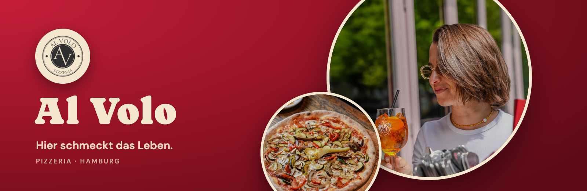
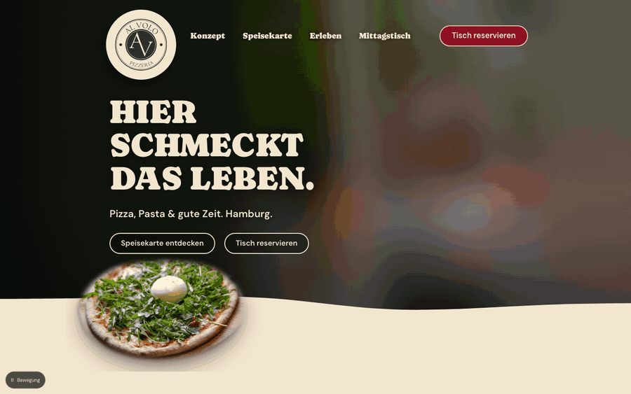
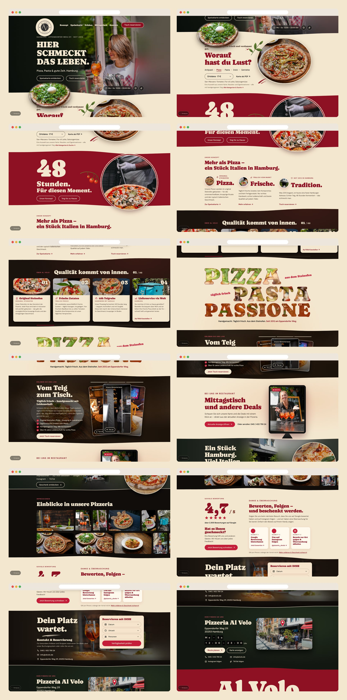
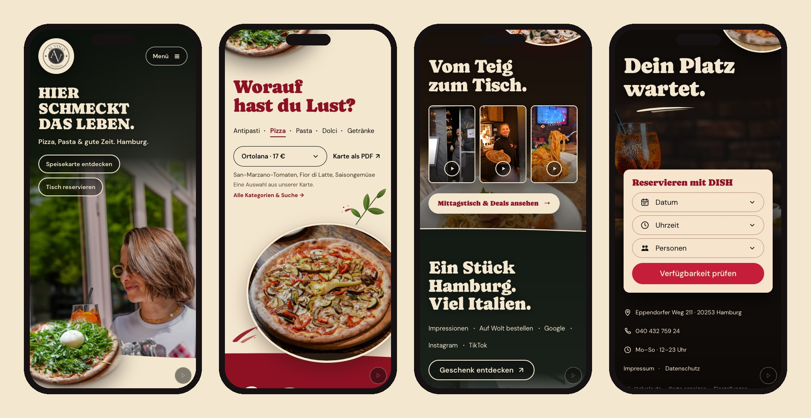
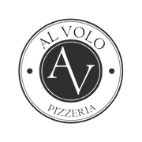

<div align="center">



<h3>A one-page website for a neighbourhood pizzeria in Hamburg, where every scene opens like a camera iris onto a real moment at the restaurant.</h3>

<p>
  <a href="https://al-volo-hamburg.vercel.app"><strong>🌐 Live site</strong></a>
  &nbsp;·&nbsp;
  <a href="#hero-animation"><strong>🎬 How the hero works</strong></a>
  &nbsp;·&nbsp;
  <a href="#getting-started"><strong>🛠️ Run it locally</strong></a>
</p>

<p>
  <a href="https://al-volo-hamburg.vercel.app"></a>
  
  
  
  
</p>

</div>

<br />

## 🚀 Overview

**Pizzeria Al Volo** serves pizza, pasta and a good time on Eppendorfer Weg in Hamburg. The site is built from the approved board *Momenti Veri* around one idea: the round AV seal works like a **camera aperture**. Circular windows open onto real moments at the restaurant: a guest with an Aperol, a pizza fresh from the oven, the chef at work, the façade on Eppendorfer Weg.

Six scenes in German take visitors from the first impression to a **table at DISH** in a few scrolls. Each scene enters with its own gesture, and wave-shaped seams carry the eye from one scene to the next.

- **Cinematic first impression**: the portrait opens in a circular iris and the three title lines settle in, with no zoom on the subject
- **The real restaurant only**: 14 original photos and 3 original videos from Al Volo; the video posters are frames of those videos
- **Clear path to a table**: *Tisch reservieren* in the header, the hero and the last scene opens the restaurant's real DISH reservation, with the phone number as a fallback
- **Light**: 1.66 MB on first load at 1440 × 900 (1.02 MB on a phone) and 2.06 MB after scrolling the whole page; the 7.4 MB of video only loads when a visitor presses play

<br />

<a name="hero-animation"></a>

## 🎬 The hero animation

<div align="center">
  <a href="https://al-volo-hamburg.vercel.app"></a>
  <sub>Every entrance played frame by frame from the running page · captured at 1440 × 900</sub>
</div>

<br />

The intro plays once per visit. After that, each scene enters the first time it comes into view:

| Scroll                          | What happens                                                                                                  |
| :------------------------------ | :------------------------------------------------------------------------------------------------------------ |
| Load                            | The portrait opens from a 0% to a 110% circle in 1.25 s; the three title lines rise 12 px, 90 ms apart          |
| Leaving the hero                | Gentle parallax: the guest drifts up to 8 units, the title −4, the burrata −10/−4 and the seal turns up to −3° |
| **Worauf hast du Lust?**        | The pizza opens in a circular iris; a basil sprig draws its stem, then its leaves; a brush stroke wipes in      |
| **48 Stunden.**                 | The chef's window irises open while **48** counts up from 0; a tomato vine draws itself and the tomatoes drop  |
| **Vom Teig zum Tisch.**         | Three video cards are dealt onto the table one after another, then *Mittagstisch & Deals* rises               |
| **Ein Stück Hamburg.**          | The façade is revealed by an arched wipe rising from below, and a pizza rolls in from the right                                  |
| **Dein Platz wartet.**          | A swoosh underlines the title and the DISH card rises into place                                              |

**Under the hood**

- 📐 **One unit for the whole page.** Everything is laid out in canvas units: `--u = min(1px, 100vw / 1024, 100svh / 760)`. The layout never grows past the approved board, so a 1920 px window shows the same title, portrait and pizzas as a 1024 px one. On short windows the height cap keeps the hero inside one screen.
- 🎯 **Measured against the board.** The board was drawn at 752 px. SIFT feature matching with RANSAC found which real photo each circle uses, plus its crop and scale. Those numbers were converted to canvas units (× 1024 / 752).
- 🌊 **Waves in canvas units.** Each scene's background reaches up into the previous one and is cut by an SVG wave mask. The masks are drawn on the same 1024-unit grid (viewBox −1500 → 2524), so the curves keep their shape at any window width. Cream seam lines share that viewBox.
- 🌫️ **Photos that melt into themselves.** Behind each scene photo sits a blurred plate of the same photo, extended past its edges by push-pull diffusion (`scripts/prepare-plates.py`). There is no visible edge, no mirroring and no second picture.
- 🐢 **Graceful by default.** `prefers-reduced-motion`, the *Bewegung* pause button and Save-Data all show every scene in its final state. Scrolling stays native, and nothing runs in a continuous render loop.

<br />

## 🖥️ Sections

<div align="center">
  
</div>

<br />

| #   | Section                                  | Anchor         | Role                                                                                                  |
| :-- | :--------------------------------------- | :------------- | :---------------------------------------------------------------------------------------------------- |
| 01  | **Hier schmeckt das Leben.**             | `#home`        | First impression, with menu and reservation calls to action                                            |
| 02  | **Worauf hast du Lust?**                 | `#speisekarte` | Pizza macro, category tabs and a dish picker; *Alle Kategorien & Suche* opens the full selection; PDF menu |
| 03  | **48 Stunden. Für diesen Moment.**       | `#konzept`     | The dough story on solid red, with *Unser Konzept* and *Teig für zu Hause*                              |
| 04  | **Vom Teig zum Tisch.**                  | `#erleben`     | Three original videos, played on request, and the lunch & deals display                                 |
| 05  | **Ein Stück Hamburg. Viel Italien.**     | `#pizzeria`    | Façade, a 12-photo gallery, Wolt, Google reviews, Instagram, TikTok and the gift voucher                |
| 06  | **Dein Platz wartet.**                   | `#reservieren` | Three steps (date, time, guests) that open the restaurant's DISH reservation                           |
| 07  | Footer                                   | `#kontakt`     | Address, phone, opening hours, map, email, Impressum and Datenschutz                                   |

<br />

## 📱 Mobile first, motion optional

<div align="center">
  
</div>

<br />

- Below 720 px the page uses its own composition instead of a shrunken board: text first, then the portrait, with the burrata on the seam
- The menu circle, video cards, façade and reservation card each move into the reading flow
- No horizontal scroll from 375 to 1920 px wide and no text under 11 px in the page content (checked in the browser QA)
- Pointer parallax only runs on fine pointers; nothing depends on hover

<br />

## ✨ Highlights

- **🍕 Menu with search**: 21 dishes in eight categories with prices checked against the PDF menu, which stays one tap away for the full list
- **📅 Real reservations**: the restaurant's own DISH widget, with the phone number as a fallback and no fake "booking confirmed" screen
- **🔒 Nothing external until asked**: DISH, the deals display and Google Maps load only when the visitor asks, a stored choice can be changed under *Einstellungen*, and the fonts are self-hosted
- **🎞️ Original videos**: three vertical MP4s with sound that start only on a tap and pause when the player closes or the tab is hidden
- **🖼️ Gallery lightbox**: the 12 photos of the official gallery, each one enlargeable
- **🧪 Browser QA**: `npm run qa` runs 126 checks across 8 window sizes, covering density, overflow, console errors, missing files, tiny text, upscaled photos, every dialog and link, and motion on and off
- **🔎 Ready to share**: Open Graph image, `Restaurant` structured data and favicons; `noindex` until the client's own domain is live

<br />

## 💻 Tech stack

| <br />HTML5 | <br />CSS3 | <br />JavaScript | <br />Python | <br />OpenCV | <br />Playwright | <br />FFmpeg | <br />Vercel |
| :---: | :---: | :---: | :---: | :---: | :---: | :---: | :---: |

### Why this stack?

- **Static HTML, CSS and JavaScript**: the `site/` folder is the whole website, with no build step and no framework runtime; it can be opened locally or put on any static host
- **CSS custom properties**: one unit variable drives every size and position, so the board's proportions hold at every width
- **Python, OpenCV and FFmpeg, offline only**: they measured the board, built the blurred plates and pulled the video posters; the site never depends on them
- **Playwright**: a real Chrome checks every window size, dialog and link
- **Vercel**: static hosting straight from `site/`

<br />

## 🎨 Design system

| Token    | Value                                                                        | Use                                         |
| :------- | :--------------------------------------------------------------------------- | :------------------------------------------ |
| Red      |  | Brand red, reservation button, menu titles  |
| Wine     |  | The 48-hour scene, header button            |
| Cream    |  | Menu scene, seams, seal base, text on dark  |
| Card     |  | DISH card and dialogs                       |
| Ink      |  | Dark scenes and body text on cream          |
| Leaf     |  | Basil and vine accents                      |

- **Type**: Caprasimo for titles (hero title capped at 76 units) and DM Sans for text and interface, both self-hosted under the OFL
- **Grid**: a 1024-unit canvas centred in the window; backgrounds run edge to edge while content keeps the board's size
- **Scenes**: hero 720 units tall, then 470, 477, 443, 381 and 400 units, joined by wave seams
- **Motion**: one entrance per scene, 0.45 to 1.3 s, played once; the subjects are never scaled

<br />

<a name="getting-started"></a>

## 🛠️ Getting started

```bash
# Clone the repository
git clone https://github.com/Jeanfr1/Al-Volo-website.git
cd Al-Volo-website

# Install the dev tools (Playwright for QA and captures; the site itself needs nothing)
npm install

# Serve site/  →  http://localhost:4437
npm run dev

# Browser QA (8 window sizes, every dialog and link)  →  docs/browser-qa.json
npm run qa

# Asset hashes, kit checker and MANIFEST.sha256, in that order
npm run manifest
```

QA and captures use a cached *Chrome for Testing* build, or the browser named in `CHROME_PATH`. To rebuild the derived images (plates, posters, seal and icons), run `python3 scripts/prepare-plates.py` with OpenCV, Pillow and FFmpeg installed. The README images come from `node scripts/readme-assets.mjs` while the dev server is running.

<br />

## 📁 Project structure

```
Al-Volo-website/
├── site/                         # The website: deploy this folder as-is
│   ├── index.html                # Six scenes: home → speisekarte → konzept → erleben → pizzeria → reservieren → footer
│   ├── styles.css                # Canvas units, scene layout, wave masks, entrances, phone reflow
│   ├── app.js                    # Intro, parallax, entrances, menu, dialogs, DISH/Maps/deals gate, videos
│   ├── content.js                # Contacts, links, videos and gallery
│   ├── menu-data.js              # The 21-dish selection from the PDF menu
│   ├── shapes/                   # Wave masks in canvas units
│   ├── photos/                   # Optimised photos, plates/ (blurred extensions), posters/ (video frames)
│   ├── videos/                   # The three original MP4s
│   ├── fonts/  brand/            # Caprasimo, DM Sans (OFL) and the original logo with display-size copies
│   └── Speisekarte-Al-Volo-Original.pdf
├── scripts/
│   ├── serve.mjs                 # Zero-dependency static server with Range support
│   ├── qa.mjs                    # Browser QA
│   ├── shots.mjs  filmstrip.mjs  # Full-page shots and natural-speed scroll contact sheets
│   ├── readme-assets.mjs         # Banner, GIF and screenshots for this README
│   ├── prepare-plates.py         # Plates, burrata cutout, posters, seal and icons
│   └── sync-manifests.py         # Asset manifest, kit checker, MANIFEST.sha256
├── references/                   # The approved board (model 1, Momenti Veri)
├── roteiros/  motion/  process/  # Art direction, scene scripts, timeline and the 1024-unit scale rule
├── docs/                         # Architecture lock, scale contract, asset hashes, QA reports
├── images/originals/             # The 14 original photos, untouched
├── tools/verificar-kit.py        # Kit checker (112 checks)
├── GUIA-VISUAL.html  LEIA-ME-KIT.md
└── vercel.json                   # Static output from site/, noindex headers
```

<br />

<a name="deployment"></a>

## 🚀 Deployment

Hosted on **Vercel** as a static site and connected to this repository: every push to `main` ships to production. There is no build command, and only `site/` is published.

**Live site:** [al-volo-hamburg.vercel.app](https://al-volo-hamburg.vercel.app)

| Setting          | Value          |
| :--------------- | :------------- |
| Framework        | Other (static) |
| Build command    | none           |
| Output directory | `site`         |

`vercel.json` also sends `X-Robots-Tag: noindex` and long cache headers for fonts, and `site/robots.txt` disallows crawling until the client's own domain is live.

<br />

## 📌 Content checklist

Items waiting on the client. Each one is marked `TODO(alvolo)` in `site/`.

- [ ] Confirm the dish selection and prices against the current authorised menu (`menu-data.js`)
- [ ] Confirm the opening hours (`content.js`, footer and structured data)
- [ ] Keep the voucher, Impressum and Datenschutz routes on alvolo.de if that hosting changes (`content.js`)
- [ ] Custom domain, then remove `noindex`, add `canonical` and `og:url`, and move `og:image` to it (`index.html`, `vercel.json`, `robots.txt`)

<br />

## 🙏 Acknowledgments

- **Pizzeria Al Volo** for the photos, videos, menu and the approved visual direction
- **[Caprasimo](https://github.com/docrepair-fonts/caprasimo-fonts)** and **[DM Sans](https://github.com/googlefonts/dm-fonts)**, both under the SIL Open Font License
- **[DISH](https://www.dish.co)** for the reservation widget the restaurant already uses
- **[Playwright](https://playwright.dev)**, **[OpenCV](https://github.com/opencv/opencv)**, **[FFmpeg](https://ffmpeg.org)** and **[Vercel](https://vercel.com)**

<br />

---

<div align="center">
  
  <p><strong>Hier schmeckt das Leben.</strong></p>
  <p>Built with ❤️ by <a href="https://github.com/Jeanfr1">Jean</a> for Pizzeria Al Volo</p>
  <sub>© 2026 Pizzeria Al Volo. All rights reserved.</sub>
</div>
